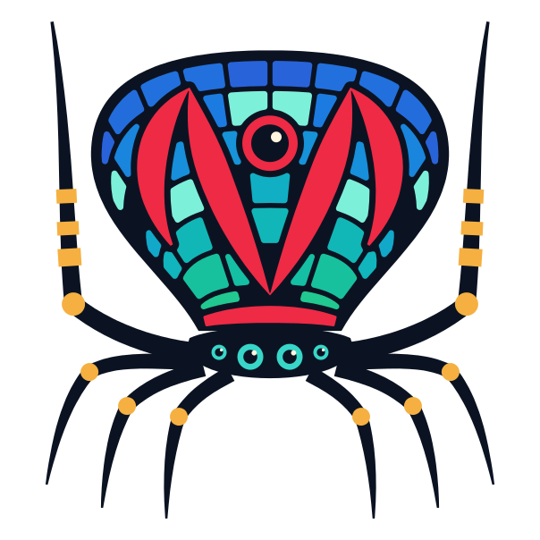

<picture>
  <source media="(prefers-color-scheme: dark)" srcset="../../assets/maratus-mark-on-dark.svg">
  <source media="(prefers-color-scheme: light)" srcset="../../assets/maratus-mark-on-light.svg">
  
</picture>

# WebSocket chat example

This example hosts or joins a session, shows its lifecycle events and peer ID,
and exchanges typed string RPCs through a mounted Flame component with every
ready participant. The host also spawns a replicated avatar for each
participant, so every canvas shows the same row of avatars. A host running
the Flame app animates those avatars and synchronizes their vertical offsets
to clients, which smooth them between samples. Windows can host or join;
browsers join a native host. A small command-line host also works on native
Dart without a desktop build, and a simulated network inside the app
reproduces latency, stalls, and dropped connections.

The example is part of the repository's workspace. Resolve dependencies from
the repository root or from this directory:

```sh
flutter pub get
```

Run the commands below from this directory.

## Native host and browser clients

Start a host in one terminal:

```sh
dart run bin/host.dart 8080
```

In a second terminal, start the browser app:

```sh
flutter run -d chrome
```

Join `ws://localhost:8080/netcode`. Open the app in a second browser tab and
join the same host. When both show `ready`, send a message: the host and both
tabs display the original sender's peer ID and text. Each sender sees the
host's delivery of its message, so a displayed message confirms dispatch.

Both tabs show an avatar for each tab, in the same order and colors, with
`You` beside their own. The command-line host is a dedicated host, so it has
no avatar itself and does not run the Flame avatar animation.

Use Disconnect, then Join again to see a new peer ID: the other tab drops the
old avatar and shows the new one. Stopping the host returns clients to
`disconnected` and clears their avatars. The activity view retains the latest
100 entries.

## Windows host or client

With Flutter's Windows build tools installed:

```sh
flutter run -d windows
```

Select Host to listen on the chosen port, or enter a URL and select Join.
With a native app hosting, avatars bob vertically on every connected canvas;
the host simulates movement and clients display its synchronized offsets.
Hosting binds `0.0.0.0`, so other devices on the same network can connect using
the host computer's LAN address, such as `ws://192.168.1.20:8080/netcode`.
`localhost` always means the device running the client. Allow the chosen port
through the host's firewall when testing across devices.

The checked-in runners support Windows and web. For macOS or Linux, generate
the runner with `flutter create --platforms=macos .` or
`flutter create --platforms=linux .` on the corresponding platform.
An HTTPS-served browser app needs a `wss://` endpoint, typically provided by a
TLS reverse proxy in front of the native host.

## Simulated network

Select Simulate, on any platform, to run a host and a second client inside the
app, joined by in-memory links with 30 ms of latency. This participant joins
over its own link, and two small canvases show the simulated host and client.
Each scenario button reproduces one condition:

| Scenario | What happens | What to watch |
| -------- | ------------ | ------------- |
| Latency spike | This participant's link slows to 300 ms for three seconds. | The round trip grows past 600 ms; avatars hold, then move smoothly again, further behind. |
| Host stall | The simulated host stops updating for two seconds. | Avatars hold their last values instead of extrapolating, then resume. |
| Client stall | The simulated client stops updating for four seconds. | On the host, that client's queue stops at the state threshold, and its avatar state is held and coalesced instead of queued. |
| Drop and rejoin | This participant's link fails, and it joins again a second later. | It leaves with `transportError`, then rejoins with a new peer ID and avatar. |

Turn on Diagnostics to show each session's peers, round trips, queue depths,
traffic rates, entity count, held and coalesced state, and how avatars are
smoothed. Turn Smoothing off to show offsets as they arrive, in 50 ms steps.
Disconnect ends the simulation.

## How it works

`lib/chat_protocol.dart` is shared by the UI and command-line host. Each peer
registers `example.chat` with a 240-code-unit string codec, any-peer caller
permission, all-peer targeting, and local execution included. Each registers
the same static entity, ID 1, with the host as its owner and authority, after
starting its session. The command-line host imports only `package:maratus`,
which has no Flutter dependency, and binds directly to that entity.

`lib/chat_controller.dart` owns the UI session and `ChatGame`, which is displayed
by a Flame `GameWidget`. Each connection creates a `MultiplayerScope` containing
one `ChatNetworkComponent`. Its `onNetworkAttach()` binds the typed RPC through
an `EntityAttachment`; it becomes ready only after mounting. The scope consumes
network arrivals before gameplay updates, then calls `captureNetworkState()`.
The component handles messages, animates a small pulse during its update, and
captures the received-message count for the canvas panel after gameplay.
The scope then calls `session.captureState()` to sample due synchronized
properties after all component capture hooks have run.

The canvas shows the last message and received count from the mounted component.
The surrounding Flutter activity log updates after the game frame. There is no
separate polling timer. Even host-local calls wait for the scope's next update,
so gameplay handlers share the same update boundary. Sending becomes available
when the component is ready and the session is hosting or has finished joining.

Avatars are replicated entities. `ChatProtocol` also registers the
`example.avatar` spawn type, whose construction data is a color index. The
host spawns its own avatar when it starts and one for each client that joins,
owned by that client with `OwnerLeftPolicy.despawn`, so a departing client's
avatar is despawned for everyone else. The command-line host spawns client
avatars the same way. Each scope also holds a `MultiplayerSpawner` whose
factory creates an `AvatarComponent` from the replicated entity and its
color. A joining client receives the existing avatars and becomes ready once
they have mounted. The game lays avatars out in entity order, which every
participant shares.

`ChatProtocol` registers `example.avatar.offset` as a bounded double field.
Each `AvatarComponent` binds its `verticalOffset` through
`attachment.synchronize()` in `onNetworkAttach()`, with a
`DoubleInterpolator`. Only the host advances the animation during gameplay.
The synchronizer samples changed offsets at the default 50-millisecond
interval using the session clock; clients apply received offsets before their
gameplay update. With smoothing on, each client shows the interpolated offset,
100 milliseconds behind the host's samples; `verticalOffset` keeps the latest
authoritative value either way. Joining clients receive retained offsets,
which apply once their avatars mount.

`lib/network_monitor.dart` turns `session.diagnostics` into the overlay's
lines twice a second, with rates between snapshots, and
`lib/network_lab.dart` runs the simulated network. Its participants are
ordinary `ChatController`s, and its scenarios are timers on the shared clock.
The lab host holds state for a congested connection after 32 unacknowledged
messages instead of the default 256, so a stalled client shows held state
within a second.

Disconnecting disposes the scope immediately, removes its component and bindings,
and closes the session. A new connection creates a fresh scope and component;
pending host attempts are cancelled when disconnected or disposed. The widget
closes its owned game and session on disposal.

Check and build the example from this directory:

```sh
flutter analyze
flutter build web
```
