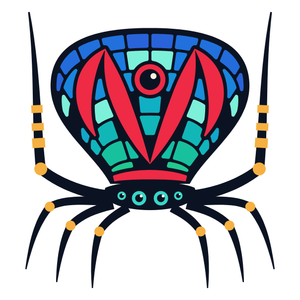

<picture>
  <source media="(prefers-color-scheme: dark)" srcset="../../assets/maratus-mark-on-dark.svg">
  <source media="(prefers-color-scheme: light)" srcset="../../assets/maratus-mark-on-light.svg">
  
</picture>

# Interpolation example

A host and two clients run side by side in one Flame game, joined by an
in-memory network. The host moves an orb and sends its position a few times a
second. One client draws each sample as it arrives, and the other blends
between the samples. Sliders change the latency, the send rate, and the
interpolation delay.

Requires Dart `>=3.11.0 <4.0.0` and Flutter `>=3.41.0`. Use Chrome for the web
runner or install Flutter's Windows build tools for the desktop runner.

## Run

From the repository root:

```sh
flutter pub get
cd examples/interpolation
flutter run -d chrome
```

Or run `flutter run -d windows`. On macOS or Linux, generate the corresponding
runner first with `flutter create --platforms=macos .` or
`flutter create --platforms=linux .`.

## Try it

Each view draws its orb, and dots at the latest samples that it sent or
received. The clients also outline where the host's orb is now.

- Watch the **each sample** client. Its orb jumps from dot to dot, ten times a
  second.
- Watch the **interpolated** client. Its orb moves smoothly through the same
  dots, but further behind the host's outline.
- Lower the **send rate**. The dots spread apart; the first client jumps
  further, and the second cuts the corners of the path, as it blends in
  straight lines between samples.
- Raise the **latency**. Both clients fall further behind the host, but the
  motion of the interpolated orb stays smooth.
- Lower the **interpolation delay** below one interval. The interpolated orb
  catches up with the newest sample before the next one arrives, and stops
  until it does. Its caption counts how often it waits.

Releasing a slider starts the host and the clients again with the new
settings.

## Explore the code

- [orb.dart](lib/orb.dart): the orb. It synchronizes its position with
  `attachment.synchronize`. The host samples the position once per
  `interval`. A client with a `Vector2Interpolator` receives positions blended
  between the samples, `interpolationDelay` behind the newest one; a client
  without one receives each sample as it arrives.
- [main.dart](lib/main.dart): the host, the clients, their views, and the
  sliders.

The orb's protocol handles are written by hand instead of generated, because
the sliders choose the interval and the delay while the game runs. With
annotations, the same field is a `@SyncedField` with
`interpolator: Vector2Interpolator()`, and `@Networked` takes a constant
`syncInterval` and `interpolationDelay`.

A client presents each sample after the network's latency plus the
interpolation delay. The delay leaves a newer sample to blend towards; two
intervals, the default, allow one late sample. Interpolation never
extrapolates: without a newer sample, the orb holds the newest one.

See the core
[replicated entities guide](../../packages/maratus/README.md#replicated-entities-and-state)
for synchronized fields and interpolation.
