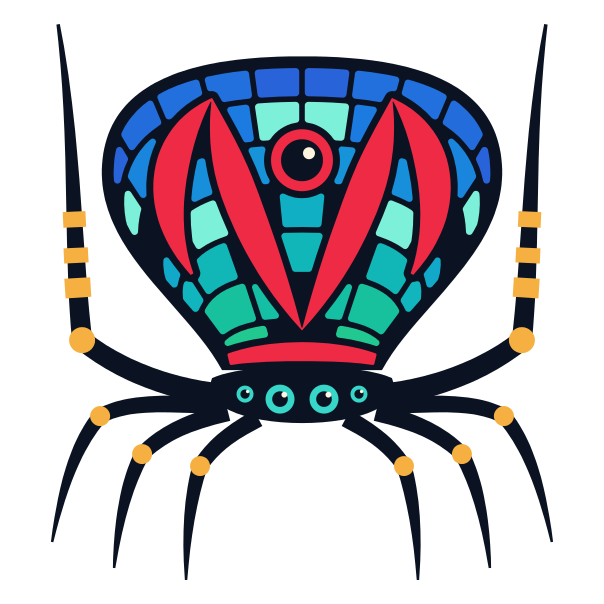

<picture>
  <source media="(prefers-color-scheme: dark)" srcset="../../assets/maratus-mark-on-dark.svg">
  <source media="(prefers-color-scheme: light)" srcset="../../assets/maratus-mark-on-light.svg">
  
</picture>

# Ownership example

A host and two clients run side by side in one Flame game, joined by an
in-memory network with 40 ms of latency each way. The host spawns one ball,
and one peer at a time owns it. Only the owner can move it, and the views'
buttons hand it from peer to peer while the game runs. A note above the ball
shows each transfer, and the host shows the calls it refuses in red.

Requires Dart `>=3.11.0 <4.0.0` and Flutter `>=3.41.0`. Use Chrome for the web
runner or install Flutter's Windows build tools for the desktop runner.

## Run

From the repository root:

```sh
flutter pub get
cd examples/ownership
flutter run -d chrome
```

Or run `flutter run -d windows`. On macOS or Linux, generate the corresponding
runner first with `flutter create --platforms=macos .` or
`flutter create --platforms=linux .`.

## Try it

The ball shows the ID of its owner, and has a white ring in the owner's view.
Each view's title also names the owner.

| Button | Where | What happens |
| --- | --- | --- |
| **◀ Move**, **Move ▶** | every view | The owner moves the ball. Any other view shows "not yours to move" and sends nothing. |
| **Give to next** | host | The host transfers the ball to the next peer: the host, then each client in the order they joined. |
| **Take back** | host | The host transfers the ball to itself. |
| **Claim** | client | Calls `claim`, which anyone may call. The host gives the ball to the caller. |
| **Pass to next** | client | Calls `pass`, which only the owner may call. The host gives the ball to the next peer. |

Things to try:

- Move the ball on one client, then hand it to the other. The new owner
  continues from the column it received, not from where the ball started.
- Press **Pass to next** twice quickly on the client that owns the ball. The
  first pass moves the ball away, so the host refuses the second with
  `notOwner`, even though the client sent it while it still owned the ball.
- Press **Pass to next** on a client that doesn't own the ball. The host
  refuses that too.
- Press **Give to next** on the host and **Claim** on a client at the same
  time. The host applies the transfers one after another, and every view ends
  up agreeing on the owner.

## Explore the code

- [ball.dart](lib/ball.dart): the ball. Its `column` is a field that the
  owner writes (`writer: FieldWriter.owner`), so it moves with the ball. Its
  `claim` and `pass` RPCs run on the host, which calls `transferOwnership`.
- [main.dart](lib/main.dart): the host, the clients, and their buttons. Every
  view reacts to `OwnerChanged`, and the host to `RpcRejected`.

After changing the annotations, regenerate `ball.g.dart`:

```sh
dart run build_runner build
```

Only the host can transfer ownership; a client asks it with an RPC. The host
stays the ball's authority throughout. Pass `withAuthority: true` to move the
authority along with the owner.

See the core
[ownership guide](../../packages/maratus/README.md#transfer-ownership) for the
guarantees that a transfer gives.
