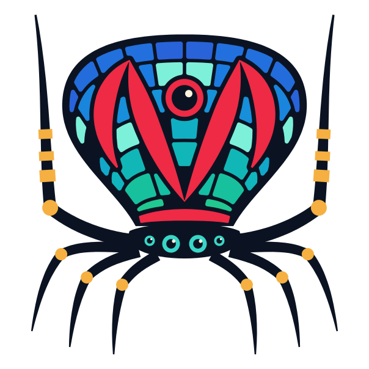

<picture>
  <source media="(prefers-color-scheme: dark)" srcset="../../assets/maratus-mark-on-dark.svg">
  <source media="(prefers-color-scheme: light)" srcset="../../assets/maratus-mark-on-light.svg">
  
</picture>

# Prediction example

A host and a client run side by side in one Flame game, joined by an in-memory
network with 150 ms of latency each way. The client steers its square with the
arrow keys and predicts where it goes, so the square moves at once instead of
after the latency. The host applies the same inputs when they arrive, and the
client reconciles its prediction with the host's state.

Requires Dart `>=3.11.0 <4.0.0` and Flutter `>=3.41.0`. Use Chrome for the web
runner or install Flutter's Windows build tools for the desktop runner.

## Run

From the repository root:

```sh
flutter pub get
cd examples/prediction
flutter run -d chrome
```

Or run `flutter run -d windows`. On macOS or Linux, generate the corresponding
runner first with `flutter create --platforms=macos .` or
`flutter create --platforms=linux .`.

## Try it

- Hold an arrow key. The square in the client's view moves at once; the one in
  the host's view follows 150 ms later. The outline in the client's view shows
  the last position that the host sent, a round trip behind.
- Let go. The outline catches up, and both views show the square in the same
  place.
- Press R. The client asks the host to respawn the square, and it jumps back
  in the client's view once the host's state arrives.

Change `PredictionGame.latency` in [main.dart](lib/main.dart) to try other
latencies.

## Explore the code

- [player.dart](lib/player.dart): the player and its prediction. Its spawn type
  and respawn RPC are generated from its annotations; the predicted position
  and the input stream are registered by hand, since annotations do not declare
  predictions yet. Every peer predicts the position with the same step,
  `Player.move`. The client advances the prediction every frame, and the host
  sets its state to respawn the player.
- [main.dart](lib/main.dart): the host and the client, their views, and the
  host spawning a player for the client.

After changing the annotations, regenerate `player.g.dart`:

```sh
dart run build_runner build
```

See the core [prediction guide](../../packages/maratus/README.md#client-side-prediction)
for how the owner and the host exchange inputs and state.
