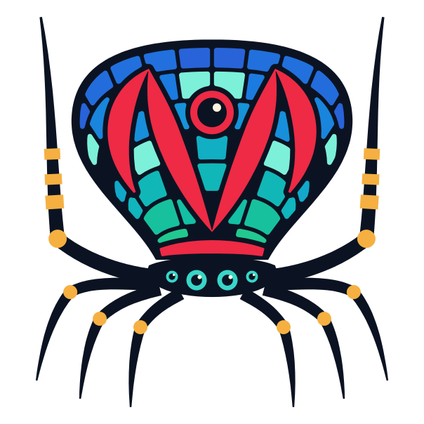

<picture>
  <source media="(prefers-color-scheme: dark)" srcset="../../assets/maratus-mark-on-dark.svg">
  <source media="(prefers-color-scheme: light)" srcset="../../assets/maratus-mark-on-light.svg">
  
</picture>

# Spawning example

A host and two clients run side by side in one Flame game, joined by an
in-memory network with 60 ms of latency each way. The host spawns and despawns
crates, and a player for each client that joins. Each client joins and leaves
with a button, and asks the host for flags. A client that joins late receives
every entity that already exists.

Requires Dart `>=3.11.0 <4.0.0` and Flutter `>=3.41.0`. Use Chrome for the web
runner or install Flutter's Windows build tools for the desktop runner.

## Run

From the repository root:

```sh
flutter pub get
cd examples/spawning
flutter run -d chrome
```

Or run `flutter run -d windows`. On macOS or Linux, generate the corresponding
runner first with `flutter create --platforms=macos .` or
`flutter create --platforms=linux .`.

## Try it

Each entity is drawn in the color of the peer that owns it, and a player shows
its owner's ID. The player that a view owns has a white ring. Below each view,
a line counts the crates, players, and flags in it.

- **Join** on a client. The client receives the crates that already exist, and
  the host spawns a player for it, which appears in every view.
- **Spawn crate** and **Despawn crate** on the host. The crates appear and
  disappear in every joined view.
- **Drop flag** on a client. The client asks the host, which spawns a flag near
  the client's player, up to six for each player.
- **Join** on the other client. It receives everything that exists, including
  the first client's player and flags.
- **Leave** on a client. Its player is despawned in every view, but its flags
  stay.
- **Join** again. The client is a new peer, with a new ID and a new player, and
  it receives the current entities again.

## Explore the code

- [world.dart](lib/world.dart): the crate, the player, and the flag. Their
  spawn types, and the player's `dropFlag` RPC, are generated from their
  annotations into the shared schema. Each takes its position from the spawn's
  data, which is sent once, when the entity spawns.
- [main.dart](lib/main.dart): the host, the clients, and their views. The host
  spawns a player when a client joins, with `onOwnerLeft:
  OwnerLeftPolicy.despawn`. A client joins with a new session in a new
  `MultiplayerScope`, and leaves by removing the scope, which closes the
  session.

After changing the annotations, regenerate `world.g.dart`:

```sh
dart run build_runner build
```

Only the host spawns and despawns entities. A client asks it with an RPC, as
`dropFlag` does, and the host decides. Every peer registers the same factories
with its `MultiplayerSpawner`, which creates a component for each entity it
receives, including those that existed before it joined, and removes the
component when the entity despawns.

An entity's owner does not decide its lifetime. The host decides what happens
to a client's entities when it leaves: the player is spawned with
`OwnerLeftPolicy.despawn`, and the flags keep the default,
`OwnerLeftPolicy.keep`. A client that leaves and joins again starts a fresh
session, with a new peer ID, and does not get its old entities back.

See the core
[replicated entities guide](../../packages/maratus/README.md#replicated-entities-and-state)
for spawning, ownership, and authority.
